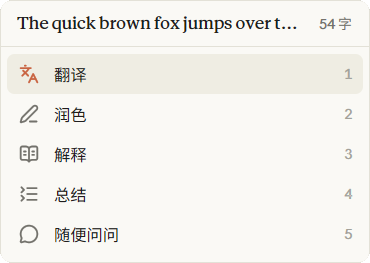
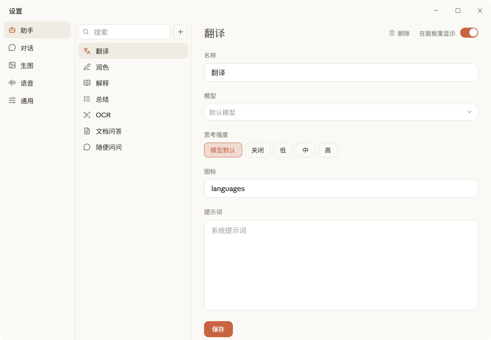

<p align="center">
  
</p>

<h1 align="center">Myuri 缪里</h1>

<p align="center">
  选中内容，按住鼠标右键，挑一个助手。<br>
  一个原生的 Windows 桌面 AI 助手，用 Rust 和 GPUI 写成。
</p>

<p align="center">
  <a href="https://github.com/TheWiseWolfHolo/myuri/releases/latest"></a>
  <a href="https://github.com/TheWiseWolfHolo/myuri/actions/workflows/ci.yml"></a>
  
  <a href="LICENSE"></a>
</p>

<p align="center">
  
</p>

## 它做什么

在任何程序里选中一段文字、一张图片或几个文件，按住右键不放，鼠标旁边弹出助手面板。
松手选中一个助手，它带着你选中的内容打开一个小窗口，流式给出回答，可以继续追问。

不用切换窗口，不用复制粘贴，也不依赖别的宿主程序。常驻内存约 60 MB。

## 功能

**唤出**

- 按住右键约 0.2 秒唤出面板，时长可调；短按和右键拖动照常工作
- 全局快捷键（默认 `Alt+Space`）
- 自动抓取选中的文字、图片和资源管理器里选中的文件，用完把剪贴板原样还原
- 全屏程序和指定程序里自动让路

**助手**

- 每个助手有自己的提示词、模型、思考强度、图标和出现条件
- 按内容类型筛选：有的助手只在选中图片时出现，有的只在选中文件时出现
- 用正则把匹配的助手排到最前；面板里支持拼音首字母搜索和数字键直选
- 自带翻译、润色、解释、总结、OCR、文档问答等七个助手，都可以改

**对话窗口**

- 流式 Markdown，追问、停止、重试、复制
- 模型分享思考过程时，折叠显示在回答上方，写明想了多久
- 对话中随时切换模型和思考强度，只列当前模型支持的档位
- 生图：选一个生图模型，调比例和质量，图片直接显示在窗口里
- 语音：麦克风听写进输入框，回复可以朗读

**渠道与模型**

- 四种对话协议：OpenAI Chat Completions、OpenAI Responses、Anthropic Messages、Gemini
- Vertex AI 服务账号登录
- 五种生图接口：OpenAI、Gemini、xAI、EvoLink、WaveSpeed
- 语音识别和语音合成：ElevenLabs、Soniox
- 一个渠道可以存多把密钥，各自备注和停用；出问题换下一把、轮流用、同一对话固定一把，三种策略
- 一键拉取渠道的模型列表并和本地比对
- 内置模型能力目录（数据来自 models.dev），知道每个模型能不能看图、怎么控制思考
- 渠道和模型自动配上厂商图标，也可以自己指定图标名、图片或网址

**设置**

- 完整的设置窗口：新建、改名、删除、拖动排序、搜索、分组折叠
- 配置是几个带注释的 TOML 文件，手改也行，保存立即生效，写错了会提示哪里有问题
- 密钥只存在 Windows 凭据管理器里，不写进任何配置文件

<p align="center">
  
</p>

## 安装

1. 到 [Releases](https://github.com/TheWiseWolfHolo/myuri/releases/latest) 下载 `Myuri-windows-x64.zip`，解压到任意位置。
2. 运行 `myuri.exe`，托盘里会出现图标。
3. 左键点托盘图标打开设置，在「对话」里点 `+` 新建一个渠道：填接口地址、选请求格式、粘贴密钥、拉取模型列表。
4. 在「通用」里选一个默认模型。
5. 随便选中一段文字，按住右键。

需要 64 位的 Windows 10 或 11。想开机启动，在托盘菜单里勾上「开机自启」。

## 配置文件

都在 `%APPDATA%\Myuri\`：

| 文件 | 内容 |
| --- | --- |
| `config.toml` | 手势、快捷键、主题、默认模型、语音 |
| `assistants.toml` | 助手列表，顺序就是面板里的顺序 |
| `prompts\*.md` | 每个助手的系统提示词 |
| `providers.toml` | 渠道、模型列表、分组、收藏、密钥备注和调用策略 |

每个文件开头都有字段说明。日志在 `%LOCALAPPDATA%\Myuri\logs\myuri.log`，只记录内容的类型和长度，不记录内容本身。

## 命令行

```text
myuri                             启动
myuri settings                    打开设置窗口
myuri check                       检查配置文件
myuri ask <助手> [文字]           不开窗口直接问，可以接管道
myuri image <渠道> <模型> <描述>  生成图片
myuri models fetch <渠道>         拉取渠道的模型列表并比对
myuri models refresh              更新模型能力目录
myuri key <渠道>                  从标准输入读密钥，存进凭据管理器
myuri quit                        退出
```

## 从源码构建

需要较新的 Rust stable（MSVC 工具链）。

```sh
cargo test
cargo build --release
```

产物是 `target\release\myuri.exe`，单个文件，没有运行时依赖。

代码分两个包：`crates/myuri-core` 是纯逻辑（手势状态机、配置、各家协议的请求和解析），不碰 Win32 也不碰界面，全部有单元测试；`crates/myuri` 是程序本体（鼠标钩子、内容抓取、托盘、窗口、网络）。

## 隐私

Myuri 没有服务器，也不收集任何数据。你选中的内容只会发给你自己配置的渠道。密钥由 Windows 凭据管理器保管。

## 现状

项目还很年轻，每天都在用也每天都在改。对话和生图用得最多；语音、Gemini 和 Anthropic 原生协议测得相对少。遇到问题欢迎提 [Issue](https://github.com/TheWiseWolfHolo/myuri/issues)。

接下来要做的：对话历史、MCP 工具、WebDAV 同步、设置的导入导出。

## 致谢

- [GPUI](https://www.gpui.rs/) 和 [gpui-kit](https://github.com/longbridge/gpui-kit)：界面框架和组件
- [models.dev](https://models.dev)：模型能力数据
- [Lucide](https://lucide.dev)：线条图标
- [Lobe Icons](https://github.com/lobehub/lobe-icons)：模型和厂商图标

## 许可证

[Apache-2.0](LICENSE)
